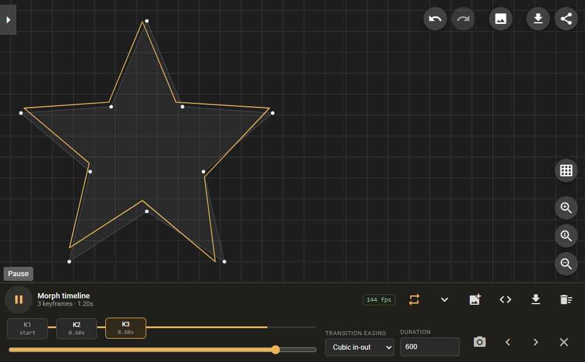

# SvgPathEditor + Morph Timeline

**Turn any set of SVG paths into a smooth morphing animation — in the browser.**

[](./docs/assets/demo.gif)

> **This is a fork.** Upstream: [Yqnn/svg-path-editor](https://github.com/Yqnn/svg-path-editor)
> (Apache-2.0, commit `937d75a`). The original editor is unchanged; this fork adds a
> keyframe-based **path morphing animation** system on top of it. See [NOTICE](./NOTICE)
> for the full list of added and modified files.

Circle → square → star, captured straight from the running app. The orange line is
the interpolated frame, the faint white outline is the editable source path.

## Why this exists

Upstream SvgPathEditor is a purely static path editor — every edit produces a
snapshot, and there is no way to animate between two shapes. This fork adds a
morph timeline that turns any set of paths into a smooth animation.

The hard part of path morphing is not the UI, it is geometry: two paths that use
different command sequences cannot be interpolated point by point. This fork
solves that properly instead of shipping a skin.

| Capability | What it does |
|---|---|
| Geometry normalisation | Any SVG command (`M L H V C S Q T A Z`, absolute or relative) is converted into cubic Bézier segments, so shapes with different command mixes can be interpolated |
| Arc conversion | Elliptical arcs become cubic curves via the SVG 1.1 F.6.5 endpoint→centre algorithm, sliced at ≤90° per cubic (≈0.027% max radial error) |
| Sub-path matching | Different sub-path counts are paired by collapsing extras onto their own anchor instead of being dropped |
| Start-point alignment | Closed shapes are rotated/reversed to the cheapest anchor match, which removes the "twisted ribbon" artefact |
| Segment padding | Shorter paths are padded with zero-length segments so the shape does not drift mid-transition |
| Timeline UI | Add / reorder / delete keyframes, per-transition easing (9 curves), per-transition duration, scrub, play, loop, live fps readout |
| Export | Animated SVG (SMIL, easing baked into sample timing) and a standalone HTML player with no external dependencies |

### Using the timeline

1. Draw or paste a shape in the path field.
2. Press the <kbd>add_photo_alternate</kbd> button in the **Morph timeline** bar to capture it as `K1`.
3. Change the path to a second shape, press the button again to capture `K2`.
4. Pick an easing curve and duration for the transition, then press play.
5. Export with the `<>` button (animated SVG) or the download button (HTML player).

The orange overlay is the interpolated frame; the dimmed white outline is the
editable source path. The overlay never writes back into your path data — the
animation is always derived, never baked in.

## Measured results

Not estimates — these come from the checked-in scripts in `tools/morph-check/`.

| Metric | Result |
|---|---|
| Unit tests | **126 passing** (55 upstream tests untouched + 71 new) |
| Frame cost, 6 keyframes × 120 segments | avg 10.36 ms · p95 **14.20 ms** · 0 long tasks |
| Responsive | 1440 / 1024 / 768 / 390 px, no horizontal overflow |
| Exported SVG | 640×614, SMIL frames verified distinct by pixel hash |
| Exported HTML | 15.7 KB, plays offline with no console errors |

Reproduce it yourself:

```bash
npm start                                    # dev server
export BROWSER_PATH=/path/to/chrome
node tools/morph-check/e2e-acceptance.mjs    # end-to-end + export verification
node tools/morph-check/perf-benchmark.mjs    # frame timing under heavy load
node tools/morph-check/responsive-check.mjs  # four breakpoints
```

## Known limitations

- SMIL is deprecated in Chrome (not removed). For long-lived output prefer the HTML player.
- The SVG exporter samples at 30 fps; very fast transitions may show slight stepping. Raise `samplesPerSecond` for denser sampling.
- Start-point alignment is heuristic: above 256 segments the search samples every 32nd offset rather than exhaustively.

---

## Upstream documentation

# SvgPathEditor
Edit or create SVG paths in browser: https://yqnn.github.io/svg-path-editor/
[](https://yqnn.github.io/svg-path-editor/)

## How to Use

##### Basic:
- Paste or edit the raw path in the **path** field
- Click on **+** to add a new command to the path, select a type, then click on the destination
- Move points with drag and drop
- Click on a point, then on the **...** button to insert a command right after the selected one, to remove it, or to change its type

##### Commands panel:
- Click on the command type to toggle between relative and absolute coordinates
- Relative command types are **orange**, absolute are **purple**
- Click on **...** then **Delete** to delete a command
- Click on **...** then **Insert after** to insert a new command right after the selected one
- Click on **...** then **Convert to** to convert the selected command to a new type
- Click on **...** then **Start Path From Here** to reorder the path so that the selected command becomes first
- Click on **...** then **Start Subpath From Here** to reorder the path so that the selected command becomes first in its subpath
- Click on **...** then **Reverse Subpath** to reverse the command order in the subpath of the selected command

##### ViewBox:
- Use mouse wheel, or click **Zoom in** and **Zoom out** to zoom in/out
- Use drag & drop to move the viewBox
- Click on **Zoom to Fit** to automatically set the viewBox depending on current path
- ViewBox can also be set manually with the **x**, **y**, **width** and **height** fields

##### Path operations:
- Scale the full path with the **Scale** button
- Translate the full path with the **Translate** button
- Rotate the full path with the **Rotate** button
- Round all coordinates of the current path with the **Round** button
- Convert all commands to relative or absolute coordinates with **Convert to relative** or **Convert to absolute** button
- Reverse the command order with the *Reverse* button
- Minimise the path length with the *Optimize* button

##### Shortcuts:
- Press **m**, **l**, **v**, **h**, **c**, **s**, **q**, **t**, **a** or **z** to insert a command after the selected one
- Press **shift** + **m**, **l**, **v**, **h**, **c**, **s**, **q**, **t**, **a** or **z** to convert selected command to a new type
- Press **echap** to delete the command being created, or the undo the current dragging operation
- Press **delete** or **backspace** to delete the selected command
- Press **ctrl** + **z** or **cmd** + **z** to undo
- Press **ctrl** + **shift** + **z** or **cmd** + **shift** + **z** to redo
- Press **ctrl** while dragging to ignore `snap to grid` constraint

## Library

The library that powers the app is now available as a standalone package: [`svg-path-editor-lib`](https://www.npmjs.com/package/svg-path-editor-lib).

## Running Locally

### With Node.js

##### Requirements
- [Node.js](https://nodejs.org/) v18.13 or higher.

##### Dependencies
Run `npm install` to retrieve all the dependencies of the project.

##### Development server
Run `npm start` for a dev server. Navigate to `http://localhost:4200/`. The app will automatically reload if you change any of the source files.

##### Build
Run `npm run build` to build the project. The build artifacts will be stored in the `dist/` directory.

##### Running unit tests
Run `npm test` to execute the unit tests via [Karma](https://karma-runner.github.io).

Karma needs to find a Chrome binary. If it hangs on
`ChromeHeadless has not captured in 60000 ms`, point it at your browser:

```bash
# Windows
set CHROME_BIN=C:\Program Files\Google\Chrome\Application\chrome.exe

# macOS / Linux
export CHROME_BIN=/Applications/Google\ Chrome.app/Contents/MacOS/Google\ Chrome
```

##### Running the morph tests only
```
npx ng test --watch=false --browsers=ChromeHeadless \
  --include='src/lib/path-morph.spec.ts' \
  --include='src/lib/morph-export.spec.ts'
```

##### Static preview of a production build
```
npx ng build --configuration production --base-href=./
npx http-server dist -p 8080
```
The build is fully static; any static file server works. Serve it over HTTP
rather than opening `index.html` from disk, because the service worker and
module scripts require an origin.

## Special Thanks
Many thanks to our sponsors 🙇 !

[@riovir](https://github.com/riovir), [@miniBill](https://github.com/miniBill), [@GitHub](https://github.com/GitHub), [@alexandernst](https://github.com/alexandernst), [@Filimoa](https://github.com/Filimoa), [@agrogers](https://github.com/agrogers), [@MilesTails01](https://github.com/MilesTails01), [@robetus](https://github.com/robetus), [@adcar](https://github.com/adcar), [@getsentry](https://github.com/getsentry), [@simplicitywebdesign](https://github.com/simplicitywebdesign) 😎, [@PassPilot](https://github.com/PassPilot), [@zeroin](https://github.com/zeroin), [@jholmes-dev](https://github.com/jholmes-dev), [@sh-csg](https://github.com/sh-csg), [@MarcoRudin](https://github.com/MarcoRudin), [@Oddpod](https://github.com/Oddpod), [@roboflow](https://github.com/roboflow), [@lasaldan](https://github.com/lasaldan), [@stevekerrick](https://github.com/stevekerrick), [@toth-istvan-zoltan](https://github.com/toth-istvan-zoltan), [@PBI-DataVizzle](https://github.com/PBI-DataVizzle), [@gucr](https://github.com/gucr), [@Guiorgy](https://github.com/Guiorgy), [@LeaVerou](https://github.com/LeaVerou), [@miham-aib](https://github.com/miham-aib), [@BarryCap](https://github.com/BarryCap), [@orangeman1066](https://github.com/orangeman1066), [@samzmann](https://github.com/samzmann), [@farin](https://github.com/farin)
